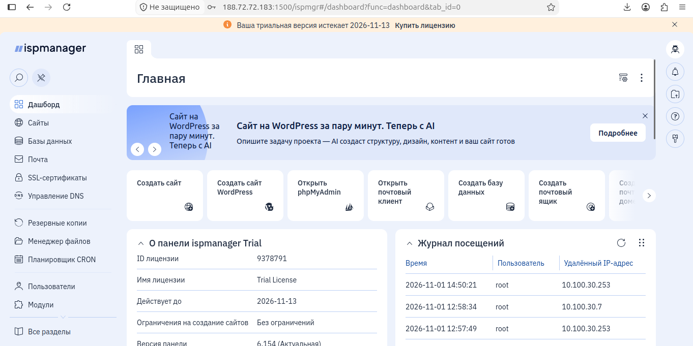
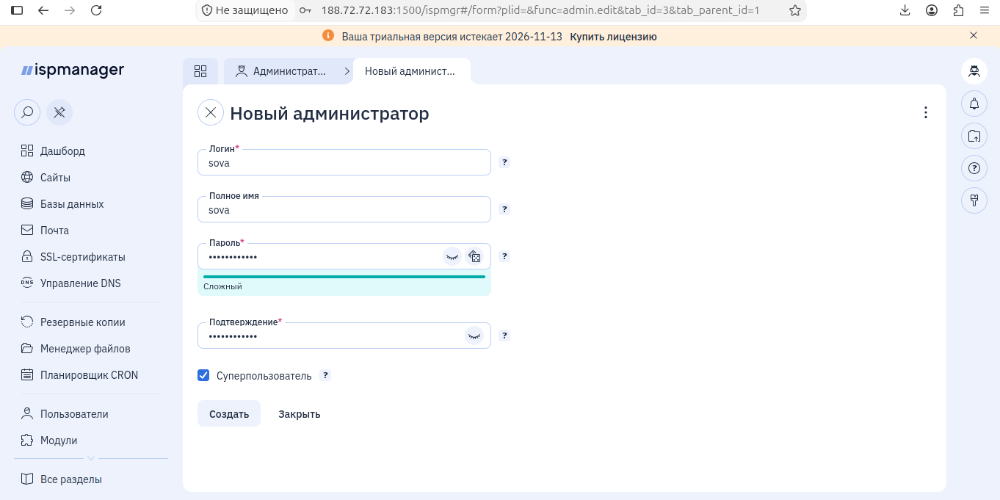
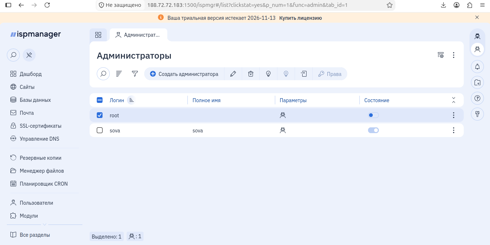
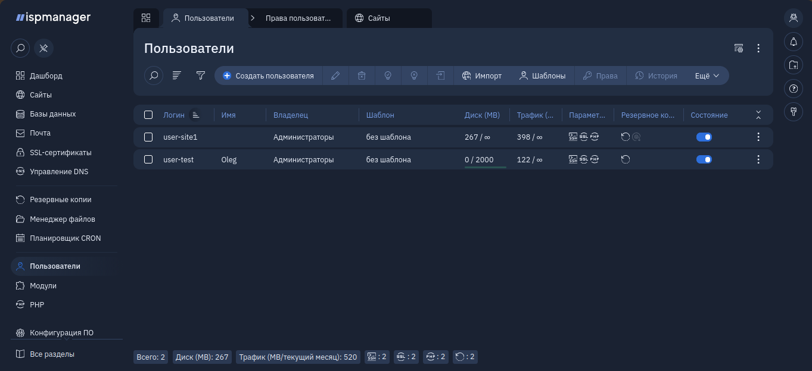
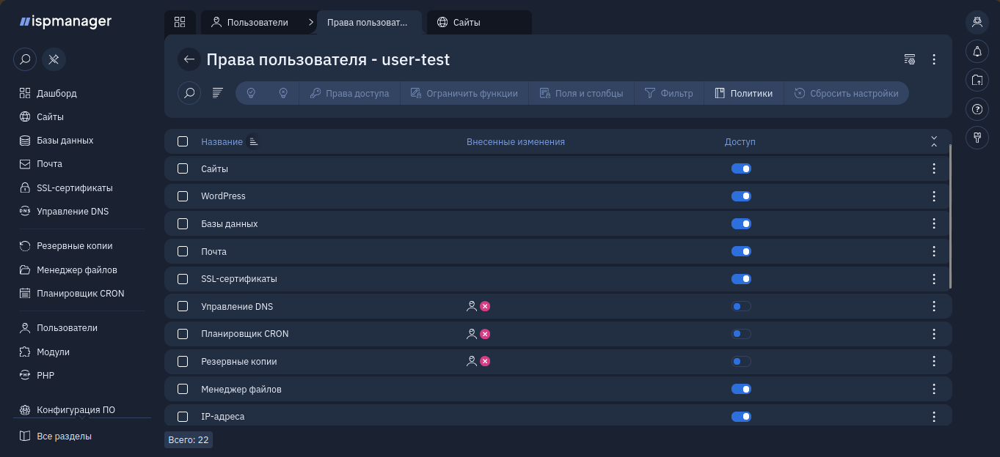

# Задание 1. Установка ispmanager на Linux,развертывание ISPmanager на Ubuntu 26.04 Server за NAT
```
1. Установка ispmanager
2. Вход в панель и активация лицензии
3. Базовая настройка панели после установки
4. Создание учётной записи администратора с правами суперпользователя
5. Создание учётной записи администратора
6. Создание учётной записи пользователя
7. Настройка доступов и ограничений для пользователя

```

Данный репозиторий содержит полную документацию по развертыванию, настройке и диагностике панели управления **ISPmanager** на сервере с операционной системой **Ubuntu 26.04 LTS** (кодовое имя `resolute`), который функционирует за NAT (в домашней сети).

## Исходные данные (Требования)
*   **Локальная машина**: Ubuntu 24.04 (используется для удаленного SSH-доступа).
*   **Сервер**: Виртуальная машина (VM) с ОС Ubuntu 26.04 Server (x64).
*   **Ресурсы сервера**: ~2.6 ГБ RAM, 98 ГБ дискового пространства.
*   **Сеть**:
    *   Внутренний IP сервера: `10.100.30.18/16` (изначально получен по DHCP).
    *   Шлюз (роутер Tenda): `10.100.30.253`.
    *   Внешний (публичный) IP: `188.$$$.$$$.183` (PPPoE).
    *   Коммутатор в сети: D-Link DES-3028 (L2).

---

## Шаг 1. Подготовка сервера

Подключаемся к серверу по SSH и обновляем систему до актуального состояния:

```
sudo apt update && sudo apt upgrade -y
```


Устанавливаем необходимые утилиты (wget для скачивания скриптов, iputils-ping для проверки сети, tcpdump для глубокой диагностики сетевых пакетов):
```
sudo apt install -y wget iputils-ping tcpdump
```

## Шаг 2. Настройка брандмауэра (UFW)

Для корректной работы панели и хостинга необходимо открыть ряд портов. Настраиваем ufw:
```
sudo ufw allow 22/tcp    # SSH
sudo ufw allow 21/tcp    # FTP
sudo ufw allow 25/tcp    # SMTP
sudo ufw allow 53/tcp    # DNS
sudo ufw allow 53/udp    # DNS
sudo ufw allow 80/tcp    # HTTP
sudo ufw allow 110/tcp   # POP3
sudo ufw allow 143/tcp   # IMAP
sudo ufw allow 443/tcp   # HTTPS
sudo ufw allow 465/tcp   # SMTPS
sudo ufw allow 587/tcp   # SMTP (Submission)
sudo ufw allow 993/tcp   # IMAPS
sudo ufw allow 995/tcp   # POP3S
sudo ufw allow 1500/tcp  # Панель ISPmanager (по умолчанию)
sudo ufw allow 1501/tcp  # Панель ISPmanager (доп.)
sudo ufw allow 3306/tcp  # MySQL/MariaDB
sudo ufw enable
```
## Шаг 3. Проверка сети и установка ISPmanager

Проверяем доступность серверов лицензий (IPv4 работает, IPv6 на сервере не настроен):
```
ping -c 4 146.0.72.149
ping -c 4 176.123.174.13
```

Скачиваем и запускаем официальный установщик:
```
cd /root
wget https://download.ispmanager.com/install.sh -O install.sh
sh install.sh
```

В ходе установки были выбраны следующие параметры:

    Ветка обновлений: s (Stable).

    Вариант установки: 1 (ISPmanager with recommended software).

    Веб-сервер: 1 (Nginx + Apache).

    Hostname: Установщик требует FQDN (имя с точкой). Было указано sova.local

    Примечание: Установщик автоматически отключил AppArmor, так как ISPmanager несовместим с ним.

## Шаг 4. Настройка статического IP (Netplan)

Изначально IP 10.100.30.18 выдавался по DHCP. Для стабильной работы проброса портов его необходимо было зафиксировать.

Столкнулись с проблемой: служба cloud-init перезаписывала настройки сети.

Решение:
Отключаем сетевое управление cloud-init:
```
echo "network: {config: disabled}" | sudo tee /etc/cloud/cloud.cfg.d/99-disable-network-config.cfg
```
Создаем конфигурационный файл Netplan
```
/etc/netplan/00-installer-config.yaml:
```
```
yaml

network:
  version: 2
  renderer: networkd
  ethernets:
    enp1s0:
      dhcp4: false
      addresses:
        - 10.100.30.18/16
      routes:
        - to: default
          via: 10.100.30.253
      nameservers:
        addresses: [1.1.1.1, 8.8.8.8]
```

 Применяем настройки:

```
sudo chmod 600 /etc/netplan/00-installer-config.yaml
sudo netplan apply
```

Результат: команда ip route теперь показывает proto static вместо proto dhcp.


## Шаг 6. Проброс портов (NAT) на роутере Tenda

В веб-интерфейсе роутера (http://10.100.30.253) в разделе Переправление портов (Port Forwarding) было создано правило:

    Внутренний IP: 10.100.30.18

    Внутренний порт: 1500

    Внешний порт: 1500

    Протокол: TCP


## Выводы и рекомендации

    Сервер успешно настроен, панель работает локально.

## Скриншоты





# Задание 2. Во второй части предстоит создать три учётные записи:

    администратор с правами суперпользователя;
    администратор;
    пользователь.

Для пользователя необходимо настроить права и ограничения:

    Ограничения:
        Диск 2 000 МБ;
        Базы данных: 2 штуки.
    Доступы:
        может использовать SSL;
        не может использовать CGI;
        может использовать PHP как модуль apache;
        не может использовать PHP в режиме CGI;
        не может использовать PHP в режиме FastCGI (Nginx + PHP-FPM);
        может использовать shell.
    Права пользователя:
        закрыт доступ к «Планировщик CRON»;
        закрыт доступ к «Управление DNS»;
        закрыт доступ к «Резервные копии».

#### Скриншоты созданного пользователя "user-test"


